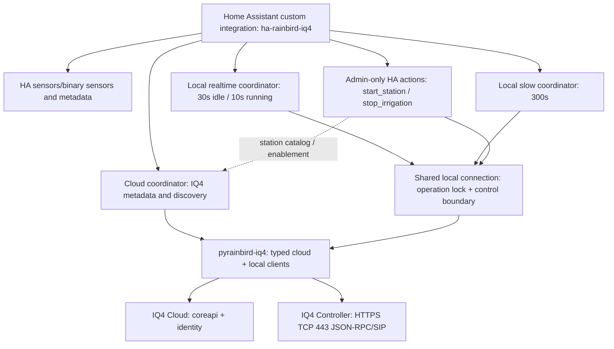

# System Architecture

## Layered design

**Architecture rule:** Python library provides protocol and model abstractions; HA custom integration owns entities, action/service policies, and HA lifecycle. The HA Core checkout is a dev runtime, not an edit target.

## Repositories

| Path inside Dev Container | Responsibility |
|---|---|
| `/workspaces/pyrainbird-iq4` | Python cloud/local protocol access, typed models, diagnostics and tests |
| `/workspaces/ha-rainbird-iq4` | HA config entry, coordinators, entities, control actions, these docs |
| `/workspaces/home-assistant-core` | HA development environment, `config/`, and the test fixtures used by `tests_ha/`; do not modify HA Core source |

## Local transport / concurrency

- TCP 443 over HTTPS with controller's self-signed certificate. Local client uses existing authenticated `AsyncRainbirdController` protocol stack.
- Response transport is **connection-close** (`keepalive=false`), and a fresh TCP connection is requested for individual local operations. Earlier keep-alive design correlated with alternating connection failures.
- `RainBirdIQ4LocalConnection` (in `coordinator.py`) owns one local client per config entry and an `_operation_lock` shared by realtime polling, slow polling and control actions. A start's preflight reads, write and post-write verification all run while holding that lock, so no poll can interleave.
- A write timeout/reset is **ambiguous**: the controller might have executed it. Never automatically retry writes.
- Local access is independent of cloud; cloud transient failures do not disable stop.

## Polling and snapshots

- Local realtime coordinator: idle ~30s; running ~10s; failure backoff 30, 60, 120s. Idle reads `active_terminals` and queue page 0; when active, additionally queue page 1.
- Slow local coordinator: every 300s; `irrigation_enabled`, `available_terminals`, `rain_sensor`, `rain_delay`.
- Cloud coordinator: approximately 300s for metadata (separate connection path).
- Control actions do **not** trust the slow coordinator's 5-minute-old rain/terminal data; start re-reads both realtime and slow state inside the lock immediately before writing.
- After any acknowledged or ambiguous write, the action requests a realtime coordinator refresh so entities update promptly.
- Partial-snapshot behavior is intentional: one failed command need not invalidate every previously valid field, but entity availability must reflect whether authoritative fields were refreshed and avoid presenting stale state as confirmed.

## Lifecycle

- `async_setup` registers both control actions **once per HA instance**, independent of config entries (HA `action-setup` pattern). They are never unregistered; a call targeting a device whose entry is not loaded is rejected with `entry_not_loaded`.
- Config-entry setup creates cloud, realtime local and slow local coordinators in `entry.runtime_data`, wires platforms, and starts scheduled updates. Setup and reload perform reads only; tests assert zero writes on setup and reload.
- On unload, platforms unload and `runtime_data` is cleared. The local client holds no persistent socket (connection-close over HA's shared session), so there is nothing further to close.
- Multiple IQ4 config entries are supported: each action call resolves the HA device to exactly one entry and that entry's own connection.

## Trust boundaries

1. **Cloud:** Authenticated remote IQ4 API; source of station IDs/names/enabled metadata; transient availability limitations.
2. **Local:** Direct access to irrigation controls and instantaneous status; write commands can physically actuate water flow.
3. **HA:** Admin authorization (`async_register_admin_service`), device-to-entry resolution, stable station IDs, schema-validated durations, and state reporting.
4. **Developer diagnostics:** Explicit opt-in and credentials prompted at runtime; never used by automated tests to water a real controller.

## Excluded from current architecture

No validated pause/resume API; no generic per-station switch semantics; no safe program-number mapping for manual program start; no normal operation requiring HA Core source patches.
